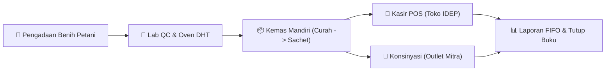
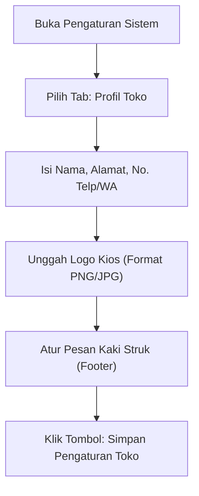
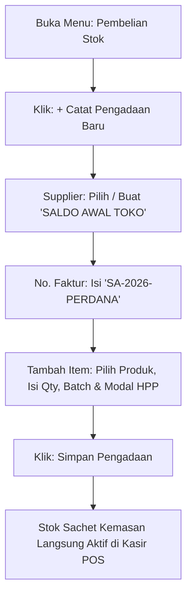
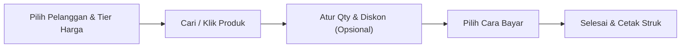
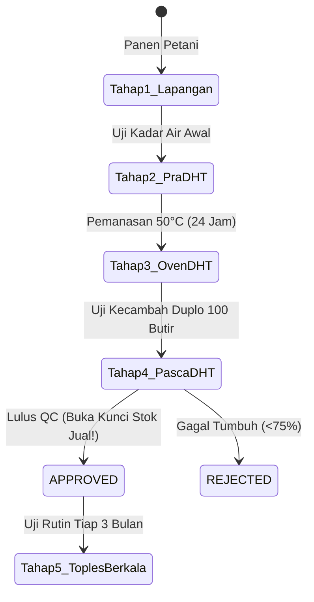
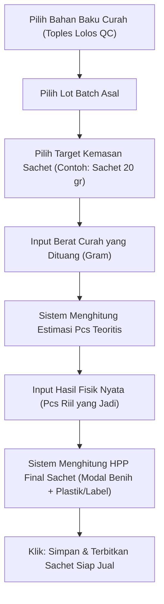
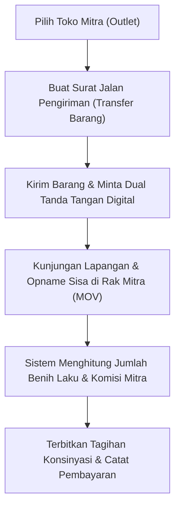
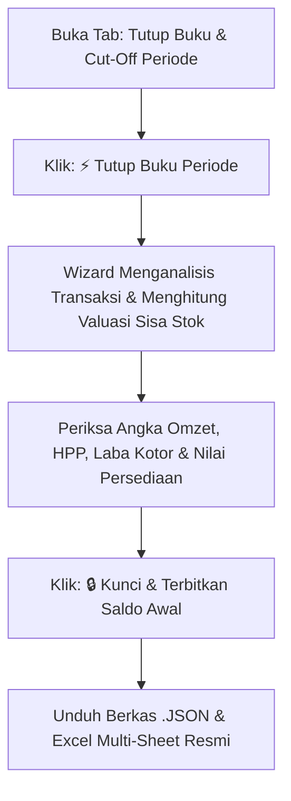

# BUKU PANDUAN PENGGUNAAN LENGKAP KIOS IDEP
### Sistem Kasir (POS), Manajemen Inventaris Benih FIFO, Konsinyasi Mitra & Akuntansi Terpadu
**Yayasan IDEP Selaras Alam — Bali**

---

## DAFTAR ISI
1. [Tentang Sistem KIOS IDEP](#1-tentang-sistem-kios-idep)
2. [BAGIAN I: PANDUAN PENGGUNAAN AWAL (SETUP & ONBOARDING)](#bagian-i-panduan-penggunaan-awal-setup--onboarding)
   - [1.1 Pemasangan Aplikasi (PWA Desktop, Tablet & HP)](#11-pemasangan-aplikasi-pwa-desktop-tablet--hp)
   - [1.2 Pengaturan Identitas Toko & Konfigurasi Struk](#12-pengaturan-identitas-toko--konfigurasi-struk)
   - [1.3 Manajemen Akun Pengguna & Hak Akses](#13-manajemen-akun-pengguna--hak-akses)
   - [1.4 Konfigurasi Printer Struk (Thermal & A4)](#14-konfigurasi-printer-struk-thermal--a4)
   - [1.5 Pendaftaran Master Produk & Impor Excel](#15-pendaftaran-master-produk--impor-excel)
   - [1.6 Penginputan Saldo Awal Persediaan (Stok Awal)](#16-penginputan-saldo-awal-persediaan-stok-awal)
   - [1.7 Registrasi Mitra Awal (Petani, Supplier & Toko Konsinyasi)](#17-registrasi-mitra-awal-petani-supplier--toko-konsinyasi)
   - [1.8 Pelaksanaan Cut-Off / Saldo Awal Pembukaan Toko](#18-pelaksanaan-cut-off--saldo-awal-pembukaan-toko)
3. [BAGIAN II: PANDUAN OPERASIONAL KESEHARIAN (SOP HARIAN PER FITUR)](#bagian-ii-panduan-operasional-keseharian-sop-harian-per-fitur)
   - [2.1 Modul Kasir (Point of Sale / POS)](#21-modul-kasir-point-of-sale--pos)
   - [2.2 Modul Pengadaan & Pembelian Bahan Benih](#22-modul-pengadaan--pembelian-bahan-benih)
   - [2.3 Modul Quality Control (QC) & Uji Semai Benih](#23-modul-quality-control-qc--uji-semai-benih)
   - [2.4 Modul Kemas Mandiri (Produksi Curah ke Sachet)](#24-modul-kemas-mandiri-produksi-curah-ke-sachet)
   - [2.5 Modul Manajemen Stok, Mutasi & Stock Opname Toko](#25-modul-manajemen-stok-mutasi--stock-opname-toko)
   - [2.6 Modul Konsinyasi Mitra & Outlet Luar](#26-modul-konsinyasi-mitra--outlet-luar)
   - [2.7 Modul Manajemen Pelanggan & Buku Piutang](#27-modul-manajemen-pelanggan--buku-piutang)
   - [2.8 Modul Laporan Penjualan, Valuasi Aset & Tutup Buku Periode](#28-modul-laporan-penjualan-valuasi-aset--tutup-buku-periode)
4. [BAGIAN III: PANDUAN PEMECAHAN MASALAH (TROUBLESHOOTING & FAQ)](#bagian-iii-panduan-pemecahan-masalah-troubleshooting--faq)

---

## 1. Tentang Sistem KIOS IDEP

KIOS IDEP dirancang khusus untuk memenuhi kebutuhan unik unit usaha sosial **Yayasan IDEP Selaras Alam**, yang memadukan:
1. **Ketertelusuran Mutu Benih (*Seed Traceability*):** Pelacakan asal-usul benih dari petani penangkar, pengujian kadar air, oven DHT (*Dry Heat Treatment*), dan uji daya berkecambah.
2. **Pengelolaan Stok Bertingkat (FIFO):** Membedakan inventaris bahan baku curah (dalam gram/kg) dan produk sachet retail siap jual (dalam pcs).
3. **Multi-Channel Distribusi:** Penjualan langsung di toko kasir, pesanan pelanggan partai, serta jaringan konsinyasi di outlet mitra (seperti Bali Buda, toko organik, dsb).
4. **Akuntansi Terpadu:** Perhitungan HPP (*Harga Pokok Penjualan*) metode FIFO, margin laba kotor riil, buku piutang tempo, dan penguncian periode cut-off tutup buku bulanan.

---

# BAGIAN I: PANDUAN PENGGUNAAN AWAL (SETUP & ONBOARDING)

Panduan ini ditujukan bagi Administrator Toko saat pertama kali mengonfigurasi aplikasi sebelum toko dibuka untuk operasional umum.

---

### 1.1 Pemasangan Aplikasi (PWA Desktop, Tablet & HP)

KIOS IDEP adalah aplikasi web progresif (*Progressive Web App / PWA*) yang dapat dipasang langsung pada perangkat tanpa perlu melalui Google Play Store atau Apple App Store.

#### A. Pemasangan di Laptop / PC Kasir (Google Chrome atau Microsoft Edge)
1. Buka browser dan akses alamat aplikasi KIOS IDEP.
2. Perhatikan bagian kanan pada bilah alamat URL (*address bar*), akan muncul ikon **"Install / Pasang Aplikasi"** (ikon komputer dengan panah ke bawah).
3. Klik ikon tersebut, lalu pilih **Install / Pasang**.
4. Aplikasi akan terbuka di jendela tersendiri tanpa bilah navigasi browser, dan shortcut desktop KIOS IDEP otomatis dibuat di layar komputer.

#### B. Pemasangan di Tablet atau Smartphone (Android / iOS)
* **Android (Chrome):** Klik menu titik tiga di kanan atas ➔ pilih **"Tambahkan ke Layar Utama" (Add to Home Screen)** ➔ klik **Instal**.
* **iOS / iPad (Safari):** Klik tombol **Bagikan (Share)** (ikon kotak dengan panah ke atas) ➔ gulir ke bawah dan pilih **"Tambah ke Layar Utama" (Add to Home Screen)** ➔ klik **Tambah**.

---

### 1.2 Pengaturan Identitas Toko & Konfigurasi Struk

Informasi identitas toko akan tercetak pada struk kasir thermal, surat jalan konsinyasi, berita acara opname, dan laporan resmi.

**Langkah-langkah:**
1. Klik menu **`⚙️ Pengaturan Sistem`** pada bilah samping.
2. Di bagian **Profil Toko**:
   - **Nama Toko:** Contoh: `Kios Benih Komunitas IDEP`.
   - **Alamat Toko:** Contoh: `Banjar Baturinggit, Desa Belayu, Kec. Marga, Tabanan - Bali`.
   - **No. Telepon / WhatsApp:** Contoh: `0812-3456-7890` (nomor ini juga akan digunakan untuk mengirim nota digital via WhatsApp).
   - **Logo Struk:** Klik tombol **Unggah Logo** untuk memilih berkas gambar logo Yayasan IDEP berlatar belakang transparan atau putih.
   - **Catatan Bawah Struk (*Footer*):** Masukkan slogan atau pesan terima kasih, contoh:  
     `"Benih Warisan Leluhur, Lestari Bersama IDEP. Simpan benih di tempat sejuk dan kedap udara."`
3. Klik tombol **`Simpan Pengaturan Toko`**.

---

### 1.3 Manajemen Akun Pengguna & Hak Akses

KIOS IDEP membagi hak akses ke dalam 2 tingkatan utama:
1. **Admin / Koordinator Unit:** Memiliki akses ke seluruh menu, termasuk tutup buku periode, pengaturan sistem, konfigurasi akun, dan koreksi data sensitif.
2. **Kasir / Staf Toko:** Berfokus pada pelayanan kasir POS, pencatatan transaksi kas, pengembalian barang, dan cetak struk harian.

**Cara Mendaftarkan Akun Baru:**
1. Masuk ke **`⚙️ Pengaturan Sistem`** ➔ gulir ke bagian **Akun Pengguna**.
2. Klik tombol **`+ Tambah Pengguna Baru`**.
3. Masukkan:
   - **Nama Lengkap:** Nama staf (contoh: `Ni Made Kasir`).
   - **Username:** Nama login singkat (contoh: `kasir1`).
   - **Peran (*Role*):** Pilih `Kasir` atau `Admin`.
   - **PIN / Password:** Masukkan kata sandi rahasia.
4. Klik **`Simpan Pengguna`**.

---

### 1.4 Konfigurasi Printer Struk (Thermal & A4)

Aplikasi mendukung dua jenis format cetak dokumen:

| Jenis Printer | Ukuran Kertas | Penggunaan Dokumen |
| :--- | :--- | :--- |
| **Printer Thermal Kasir** | 58 mm atau 80 mm | Struk belanja kasir POS harian. |
| **Printer Kantor Standar** | Kertas A4 | Surat Jalan Konsinyasi, Faktur Pajak, Berita Acara Opname, Laporan Valuasi, & Tutup Buku. |

**Pengaturan Ukuran Struk Thermal:**
1. Di menu **`⚙️ Pengaturan Sistem`** ➔ bagian **Preferensi Kasir & Struk**.
2. Pada opsi **Lebar Kertas Thermal**, pilih:
   - `58 mm` (printer portable bluetooth / mini USB).
   - `80 mm` (printer kasir POS meja berkecepatan tinggi).
3. Anda dapat mencentang opsi **"Cetak Otomatis Setelah Pembayaran Sukses"** jika ingin jendela dialog cetak langsung terbuka otomatis setelah pembayaran kasir selesai.

---

### 1.5 Pendaftaran Master Produk & Impor Excel

Produk di KIOS IDEP diklasifikasikan ke dalam:
* **Benih Kemasan (Sachet/Pcs):** Benih siap jual eceran di kasir dan outlet.
* **Benih Curah (Gram/Kg):** Bahan mentah di toples gudang penangkaran.
* **Non-Benih (Buku, Media Tanam, Kompos, Pupuk, Merchandise):** Produk jadi tanpa alur QC semai.

#### Cara A: Menambah Produk Satuan (Formulir Cerdas 2-in-1)
1. Buka menu **`📦 Produk & Katalog`**.
2. Klik tombol **`+ Tambah Produk Baru`**.
3. Isi data produk:
   - **Nama Produk:** Contoh: `Kangkung Lombok`.
   - **Jenis Produk:** Pilih `Benih`, `Buku`, `Media Tanam`, atau `Lainnya`.
   - **Kategori:** Pilih atau ketik kategori (misal: `Sayuran Daun`).
   - **Tipe Barang:**
     - Jika memilih `Bahan Baku Curah`, satuan otomatis `gr` (gram).
     - Centang opsi: **`✨ Sekaligus buatkan versi kemasan sachet siap jual (2-in-1)`** agar sistem otomatis membuatkan master sachet pasangannya dalam satu formulir simpan!
   - **Berat Kemasan (Gram):** Masukkan berat isi sachet (misal: `20` gram).
   - **Multi-Tier Harga Jual:**
     - `Harga Reguler:` Harga jual konsumen umum di toko kasir (contoh: `Rp 15.000`).
     - `Harga Outlet:` Harga khusus pasokan toko konsinyasi (contoh: `Rp 12.000`).
     - `Harga Bali Buda:` Tier khusus mitra premium tertentu (contoh: `Rp 11.000`).
4. Klik **`Simpan Produk`**.

#### Cara B: Impor Massal via Berkas Excel (.xlsx / .csv)
1. Di menu **`📦 Produk & Katalog`**, klik tombol **`📤 Impor Excel / CSV`**.
2. Klik tombol **`📥 Unduh Templat Excel (.xlsx)`** untuk mengunduh format kolom resmi.
3. Buka file di Microsoft Excel, isi kolom yang tersedia:
   - `SKU`: Kode unik produk (misal: `BNH-KGL-01`).
   - `Nama_Produk`: Nama varietas benih/buku.
   - `Kategori`: Sayuran Daun, Sayuran Buah, Media, Buku, dll.
   - `Tipe_Produk`: Benih, Buku, Media Tanam, Merchandise, dll.
   - `Satuan`: `pcs` atau `gr`.
   - `Berat_Kemasan_Gram`: Netto berat isi (misal: `20`).
   - `Harga_Reguler`, `Harga_Outlet`, `Harga_Bali_Buda`.
4. Simpan file Excel, lalu seret (*drag-and-drop*) file tersebut ke kotak unggah di aplikasi KIOS IDEP.
5. Periksa pratinjau tabel, lalu klik **`💾 Simpan Produk`**.

---

### 1.6 Penginputan Saldo Awal Persediaan (Stok Awal)

> [!IMPORTANT]
> Jangan gunakan kasir sebelum stok awal dimasukkan. Sistem KIOS IDEP menggunakan metode pemotongan FIFO, sehingga setiap butir benih atau buku yang dijual wajib memiliki nomor batch dan modal (HPP) awal.

**Langkah-langkah:**
1. Masuk ke menu **`🛒 Pembelian Stok`**.
2. Klik tombol **`+ Catat Pengadaan Baru`**.
3. Isi informasi faktur:
   - **Supplier:** Klik tombol **`+ Baru`** di sampingnya, ketik nama: **`SALDO AWAL TOKO`** *(cukup dibuat 1 kali)*.
   - **No. Faktur / Surat Jalan:** Masukkan kode referensi, misal: `SA-2026-PERDANA`.
   - **Filter Jenis Produk:** Pilih `📦 Barang Jadi Kemasan (Pcs)` atau `Semua Produk`.
4. Masukkan rincian barang:
   - **Nama Produk:** Pilih varietas sachet atau buku yang ada di toko.
   - **No. Batch / Lot:** Ketik nomor batch fisik pada kemasan (misal: `LOT-2026-001`), atau biarkan sistem membuat kode otomatis.
   - **Qty:** Masukkan kuantitas fisik riil di rak (misal: `50` pcs).
   - **Harga Beli (Rp) / HPP:** Masukkan nilai modal per pcs (contoh: `Rp 6.500`). Nilai ini menjadi acuan dasar perhitungan laba kotor saat barang terjual.
   - **Tgl Kadaluarsa:** Tentukan tanggal expired benih.
   - Klik **`+ Tambah Baris Barang`** untuk varietas lainnya.
5. Setelah semua barang terdaftar, klik **`💾 Simpan Pengadaan`**.
6. **Hasil:** Seluruh stok sachet kemasan, buku, dan media tanam berstatus **`APPROVED & NORMAL`** dan **langsung aktif siap dijual di Kasir POS**.

---

### 1.7 Registrasi Mitra Awal (Petani, Supplier & Toko Konsinyasi)

* **Petani / Penangkar Benih:** Masuk ke menu **`🛒 Pembelian Stok`** ➔ klik tombol **`+ Baru`** pada pemilih petani. Catat nama petani, desa/kelompok tani, dan komoditas unggulan mereka.
* **Toko Mitra Konsinyasi:** Masuk ke menu **`🤝 Konsinyasi Mitra`** ➔ klik tombol **`+ Tambah Outlet Baru`**. Masukkan nama toko mitra (misal: `Bali Buda Ubud`), nama PIC (*Person in Charge*), nomor telepon/WhatsApp, persentase bagi hasil/komisi, dan alamat pengiriman.

---

### 1.8 Pelaksanaan Cut-Off / Saldo Awal Pembukaan Toko

Setelah seluruh master produk dan stok awal diinput:
1. Buka menu **`📊 Laporan & Valuasi Stok`** ➔ klik tab **`🔒 Tutup Buku & Cut-Off Periode`**.
2. Klik tombol **`⚡ Kunci & Terbitkan Saldo Awal`**.
3. Sistem akan membuat arsip pembekuan posisi stok pertama Anda. Seluruh sisa fisik yang baru diinput resmi terkunci sebagai **Saldo Awal Persediaan Toko**. Anda dapat mengunduh arsip ini dalam format **`.JSON`** atau **`Excel`** sebagai dokumentasi pembukaan buku resmi.

---

# BAGIAN II: PANDUAN OPERASIONAL KESEHARIAN (SOP HARIAN PER FITUR)

Panduan operasional harian ini disusun berurutan sesuai alur kerja harian tim Kios IDEP.

---

### 2.1 Modul Kasir (Point of Sale / POS)

#### A. Memulai Transaksi & Memilih Profil Pelanggan
1. Buka menu **`🛒 Kasir (POS)`**.
2. Pada bagian atas keranjang belanja, tentukan **Profil Pelanggan**:
   - **Pelanggan Umum (Walk-in):** Menggunakan tier **Harga Reguler**.
   - **Pelanggan Outlet / Reseller:** Otomatis mengubah seluruh harga keranjang menjadi tier **Harga Outlet**.
   - **Pelanggan Bali Buda:** Otomatis menerapkan tier **Harga Bali Buda**.
3. Jika pelanggan baru, klik tombol **`+ Pelanggan`** untuk mencatat nama dan nomor WhatsApp mereka (sangat bermanfaat untuk edukasi semai berkala).

#### B. Memasukkan Produk ke Keranjang
- **Pencarian Cepat:** Ketik nama varietas atau SKU pada kotak pencarian di atas katalog.
- **Filter Kategori:** Klik tombol pill kategori (Semua, Benih, Buku, Media Tanam, dll).
- **Klik Kartu Produk:** Klik kartu produk untuk menambah 1 unit ke keranjang. Klik tanda `+` atau `-` di dalam keranjang untuk mengatur jumlah belanja.

#### C. Pengaturan Diskon & Potongan Khusus
- Di bawah daftar keranjang, terdapat kolom **Diskon**. Anda dapat memasukkan diskon dalam bentuk nominal Rupiah (misal: `5000`) atau persentase (misal: `10%`).

#### D. Memproses Pembayaran
Klik tombol hijau besar: **`Bayar Sekarang (Rp ...)`**. Jendela pembayaran akan muncul dengan 4 pilihan metode:
1. **Tunai (Cash):**
   - Ketik jumlah uang yang diterima dari pembeli, atau klik tombol nominal cepat (`Rp 20.000`, `Rp 50.000`, `Rp 100.000`, `Uang Pas`).
   - Sistem secara otomatis menghitung nominal kembalian (*change*).
2. **QRIS (Digital Pay):**
   - Menampilkan kode QRIS toko untuk dipindai oleh pembeli menggunakan aplikasi mobile banking / e-wallet apa pun (BCA, GoPay, OVO, ShopeePay, dll).
3. **Transfer Bank:**
   - Menampilkan nomor rekening bank resmi IDEP (misal: Bank Mandiri / BCA).
4. **Bayar Nanti / Piutang (Tempo):**
   - Khusus untuk pelanggan terdaftar yang memiliki izin pembayaran tempo.
   - Anda dapat menentukan **Tanggal Jatuh Tempo** pembayaran. Nilai belanja otomatis masuk ke buku piutang pelanggan.

#### E. Cetak Struk & Pengiriman Nota WhatsApp
Setelah transaksi selesai:
- Klik **`🖨️ Cetak Struk`** untuk mencetak struk belanja thermal.
- Klik **`📲 Kirim Struk WA`** untuk mengirimkan ringkasan nota digital resmi langsung ke nomor WhatsApp pembeli.

---

### 2.2 Modul Pengadaan & Pembelian Bahan Benih

Digunakan setiap kali Kios IDEP menerima pasokan gabah/benih dari petani penangkar mitra atau membeli perlengkapan toko dari pemasok luar.

1. Buka menu **`🛒 Pembelian Stok`**.
2. Klik **`+ Catat Pengadaan Baru`**.
3. Pilih **Pemasok (Supplier)** dan **Nama Petani Penangkar Mitra**.
4. Masukkan **No. Faktur Petani / Surat Jalan**.
5. Tambahkan produk yang diterima:
   - Tentukan jenis barang: apakah **Curah (gr)** atau **Kemasan (pcs)**.
   - Masukkan nomor lot/batch fisik atau gunakan generator batch cerdas aplikasi.
   - Masukkan jumlah timbangan/kuantitas yang diterima.
   - Masukkan harga beli dasar per gram / per pcs.
   - Masukkan biaya tambahan jika ada (misal: ongkos kirim atau sortir). Sistem otomatis menghitung **HPP Final (Landed Cost)**.
6. Masukkan **Tanggal Panen/Produksi** dan **Estimasi Tanggal Kedaluwarsa**.
7. Klik **`💾 Simpan Pengadaan`**.

> [!NOTE]
> Jika yang dibeli adalah **Bahan Baku Curah Benih**, stok otomatis berstatus **`PENDING_QC (QUARANTINE)`** dan diarahkan ke modul Quality Control untuk menjalani pengujian mutu sebelum boleh dikemas atau dijual.

---

### 2.3 Modul Quality Control (QC) & Uji Semai Benih

Modul ini menjaga standar mutu benih Yayasan IDEP Selaras Alam agar benih yang sampai ke tangan petani memiliki daya tumbuh tinggi.

#### Alur Pengujian 5 Tahap:
1. **Tahap 1 (Uji Lapangan Petani):** Verifikasi kebenaran varietas dan kesehatan tanaman saat panen di kebun petani.
2. **Tahap 2 (Uji Pra-DHT):** Pengukuran kadar air awal sebelum pemanasan oven.
3. **Tahap 3 (Log Oven DHT 24 Jam):**
   - Masukkan batch ke dalam oven khusus *Dry Heat Treatment*.
   - Catat nomor oven, suhu target (standar 50°C), dan waktu mulai pemanasan. Sistem akan menghitung waktu selesai tepat 24 jam kemudian.
4. **Tahap 4 (Uji Semai Pasca-DHT — Tahap Penentu Buka Kunci):**
   - Lakukan uji kecambah metode Duplo: semai 100 butir pada Tray A dan 100 butir pada Tray B.
   - Buka menu **`🔬 Quality Control`** ➔ klik **`+ Catat Uji QC Baru`**.
   - Masukkan jumlah kecambah yang tumbuh pada Tray A dan Tray B.
   - Sistem secara otomatis menghitung rata-rata **Daya Berkecambah (% Germination Rate)**.
   - Ambil foto bukti fisik baki semai menggunakan kamera laptop/HP.
   - **Hasil:** Jika daya kecambah memenuhi standar (umumnya ≥ 75-80%), status batch otomatis berubah menjadi **`APPROVED`** dan stok curah langsung terbuka untuk diproduksi di Kemas Mandiri!
5. **Tahap 5 (Uji Toples Berkala):** Pengujian ulang daya tumbuh setiap 3-6 bulan sekali untuk memastikan benih di dalam toples toples simpan tetap prima.

---

### 2.4 Modul Kemas Mandiri (Produksi Curah ke Sachet)

Digunakan ketika tim Kios IDEP memproses bahan baku curah di toples menjadi sachet kemasan siap jual retail.

**Langkah-langkah Operasional:**
1. Buka menu **`🌾 Kemas Mandiri`**.
2. **Pilih Bahan Baku Asal:** Pilih varietas benih curah yang akan dikemas.
3. **Pilih Batch Asal:** Pilih toples batch asal (hanya batch yang sudah berstatus `APPROVED` yang muncul di sini).
4. **Pilih Target Kemasan:** Pilih kemasan sachet tujuan (misal: `Kangkung Lombok [Kemasan 20 gr]`). Gramatur per kemasan otomatis terisi.
5. **Kuantitas yang Diproses:** Masukkan berapa gram benih curah yang diambil dari toples (misal: `1.000` gram).
6. **Perhitungan Estimasi vs Riil:**
   - Sistem menampilkan estimasi: `1.000 gr / 20 gr = 50 sachet`.
   - Masukkan **Hasil Jadi Riil Lapangan** pada kolom yang tersedia (misal: `49` sachet, karena ada 1 sachet bocor atau susut timbangan).
7. **Biaya Kemasan & HPP:**
   - Masukkan biaya bahan kemas per sachet (plastik klip + stiker label, misal: `Rp 500`).
   - Sistem otomatis menggabungkan modal benih per gram dengan biaya kemas menjadi **HPP Final Sachet**.
8. **Sinkronisasi Kode Batch (1:1 Traceability):**
   - Nomor batch kemasan sachet baru otomatis menyalin kode batch bahan curah asalnya, menjamin penelusuran mutu benih tetap utuh.
9. Klik tombol **`⚡ Proses & Terbitkan Kemasan Sachet`**.
10. **Hasil:** Stok curah di toples berkurang 1.000 gr, dan stok kemasan sachet siap jual bertambah 49 pcs di Kasir POS!

---

### 2.5 Modul Manajemen Stok, Mutasi & Stock Opname Toko

1. Buka menu **`📦 Stok & Batch FIFO`**.
2. **Indikator Warna Kesegaran Batch:**
   - 🟢 **Aman & Segar:** Usia benih masih baru, daya simpan panjang.
   - ⚠️ **Stok Menipis:** Sisa fisik di bawah batas minimum pemesanan ulang (*reorder point*).
   - 🔬 **Butuh Uji Semai Ulang:** Batch benih telah tersimpan lebih dari 3 atau 6 bulan di gudang, disarankan uji semai Tahap 5 di lab QC.
   - ⛔ **Kedaluwarsa:** Melewati tanggal batas aman tanam.

#### Prosedur Stock Opname Fisik Toko:
1. Masuk ke menu **`📊 Laporan & Valuasi Stok`** ➔ tab **`📦 Posisi Stok & Valuasi Aset`**.
2. Klik tombol **`📋 Cetak Lembar Opname Fisik (A4)`**.
3. Cetak formulir tersebut ke kertas A4 (atau simpan PDF). Formulir ini sengaja **menyembunyikan harga dan nilai uang** agar petugas pemeriksa (*checker*) menghitung kondisi fisik secara objektif.
4. Checker menghitung fisik toples dan sachet di rak toko, lalu menuliskan hasil hitungan pada kolom **Hitungan Fisik Nyata** serta mencatat selisih (+/-).
5. Setelah opname selesai dihitung dan ditandatangani checker:
   - Kembali ke menu **`📦 Stok & Batch FIFO`**.
   - Klik tombol **`⚖️ Penyesuaian Stok`**.
   - Pilih varietas dan batch terkait.
   - Pilih arah koreksi (`🔻 Pengurangan` jika hilang/rusak, atau `🔺 Penambahan` jika ada temuan lebih).
   - Pada alasan, pilih **`📋 Selisih Hasil Stock Opname Fisik`**.
   - Masukkan kuantitas selisih dan klik **`Simpan Penyesuaian`**.

---

### 2.6 Modul Konsinyasi Mitra & Outlet Luar

Digunakan untuk mengelola persediaan benih yang dititipkan di toko-toko mitra eksternal (seperti Bali Buda, toko organik, hotel, dsb).

#### A. Pengiriman Barang Baru ke Mitra (Surat Jalan Transfer)
1. Buka menu **`🤝 Konsinyasi Mitra`**.
2. Pilih nama outlet mitra ➔ klik **`+ Surat Jalan Pengiriman Baru`**.
3. Pilih produk sachet yang dikirim dan masukkan jumlah pcs.
4. Klik **`Simpan & Terbitkan Surat Jalan`**.
5. Buka Surat Jalan, minta **Tanda Tangan Digital Penerima** langsung pada layar sentuh HP/tablet kasir/driver.
6. Klik **`🖨️ Cetak Surat Jalan Resmi (A4)`** sebagai bukti serah terima rangkap 2 (untuk toko dan untuk mitra).

#### B. Kunjungan Berkala & Stok Opname Lapangan (MOV - Movement of Value)
1. Saat staf IDEP mengunjungi toko mitra untuk memeriksa stok:
2. Buka detail outlet di menu **`🤝 Konsinyasi Mitra`** ➔ klik **`📋 Mulai Stok Opname Lapangan`**.
3. Di depan rak display mitra, hitung berapa pcs sisa fisik masing-masing varietas:
   - Ketik angka sisa fisik pada kolom **Sisa Fisik di Rak**.
   - Masukkan barang retur (rusak/expired) jika ada barang yang ditarik kembali ke kantor.
   - Masukkan barang restock baru jika saat itu membawa tambahan stok.
4. **Kalkulasi Otomatis Sistem:**
   $$\text{Barang Terjual} = \text{Stok Awal di Rak} + \text{Restock} - \text{Retur} - \text{Sisa Fisik Akhir}$$
   Sistem secara otomatis menghitung nilai rupiah barang yang laku terjual dan menghitung hak bagi hasil/komisi milik outlet mitra.
5. Minta tanda tangan digital manajer outlet pada layar, lalu klik **`💾 Simpan Berita Acara Opname (MOV)`**.
6. Anda dapat langsung mengklik **`📲 Kirim Berita Acara via WhatsApp`** ke pihak toko mitra!

---

### 2.7 Modul Manajemen Pelanggan & Buku Piutang

1. Buka menu **`👥 Pelanggan & Piutang`**.
2. **Monitoring Piutang:**
   - Tabel menampilkan daftar nota belanja pelanggan yang belum lunas, total piutang, tanggal jatuh tempo, dan sisa hari.
   - Baris yang telah melewati tanggal tempo akan diberi tanda merah **JATUH TEMPO**.
3. **Pencatatan Pembayaran Piutang:**
   - Klik tombol **`Bayar Piutang`** pada baris nota terkait.
   - Masukkan jumlah uang yang dibayarkan oleh pelanggan (bisa dicicil bertahap atau dilunasi sekaligus).
   - Pilih metode penerimaan (Tunai / Transfer Bank).
   - Klik **`Simpan Pembayaran`**. Kuitansi tanda terima pelunasan piutang siap dicetak.
4. **Pemberitahuan Tagihan:**
   - Klik tombol **`Kirim Pengingat WA`** untuk mengirim pesan sapaan penagihan yang santun dan profesional ke nomor WhatsApp pelanggan.

---

### 2.8 Modul Laporan Penjualan, Valuasi Aset & Tutup Buku Periode

Menu **`📊 Laporan & Valuasi Stok`** menyediakan analisis komprehensif kesehatan keuangan Kios IDEP:

#### A. Tab 1: Laporan Penjualan & Margin FIFO
- Menampilkan grafik omzet harian, tren penjualan kategori, dan daftar nota penjualan.
- Mengkalkulasi **Omzet Kotor**, **Total HPP Modal Benih (FIFO)**, dan **Margin Laba Kotor Riil (Rp dan %)**.

#### B. Tab 2: Posisi Stok & Valuasi Aset
- Menampilkan seluruh batch aktif yang tersimpan di toko dan gudang.
- Mengkalkulasi total nilai rupiah aset modal persediaan:
  $$\text{Total Valuasi} = \sum (\text{Sisa Fisik Batch} \times \text{HPP Satuan})$$
- Tersedia tombol **`🖨️ Cetak Valuasi Aset (A4)`** untuk lampiran laporan akuntansi ke pimpinan yayasan.

#### C. Tab 3: Tutup Buku & Cut-Off Periode (Akhir Bulan)
Tutup buku dilakukan pada akhir setiap periode (misal: akhir bulan) untuk membekukan pembukuan, mencegah kecurangan pengeditan tanggal mundur (*anti-backdating*), dan membentuk saldo awal periode baru.

**Langkah Menutup Buku:**
1. Klik **`⚡ Tutup Buku Periode`**.
2. Wizard interaktif akan memuat seluruh transaksi yang terjadi sejak penutupan buku sebelumnya sampai hari ini.
3. Beri nama periode (misal: `Tutup Buku Oktober 2026`).
4. Tinjau rangkuman keuangan: Total Omzet, Total HPP, Laba Kotor, dan Nilai Snapshot Persediaan.
5. Klik **`🔒 Kunci & Terbitkan Saldo Awal`**.
6. **Unduh Arsip Resmi:**
   - **Tombol `💾 .JSON`:** Mengunduh arsip digital komplit (*cold backup*) untuk keamanan data IT.
   - **Tombol `📊 Excel`:** Mengunduh berkas spreadsheet multi-sheet (*Sheet 1: Ringkasan Periode* dan *Sheet 2: Saldo Awal Persediaan*).
   - **Tombol `🖨️ Berita Acara`:** Mencetak dokumen fisik resmi berita acara penutupan buku bertanda tangan Petugas dan Koordinator Yayasan.

---

# BAGIAN III: PANDUAN PEMECAHAN MASALAH (TROUBLESHOOTING & FAQ)

#### 1. Internet kantor tiba-tiba mati saat sedang melayani pembeli di kasir, apakah aplikasi masih bisa digunakan?
**Bisa.** KIOS IDEP telah dilengkapi teknologi *Progressive Web App (PWA)* dan Service Worker luring (*offline cache*). Antarmuka kasir dan data katalog produk tetap dapat dibuka tanpa sambungan internet. Transaksi yang dicatat saat luring akan tersimpan di memori perangkat dan otomatis disinkronkan ke cloud Supabase begitu koneksi internet terhubung kembali.

#### 2. Mengapa produk baru yang saya tambahkan stoknya tidak muncul di kasir POS?
Pastikan dua hal berikut:
- Jika produk bertipe **Benih Kemasan**, pastikan stok dimasukkan dengan tipe barang kemasan / pcs (bukan bahan curah gr).
- Jika barang yang dimasukkan adalah **Benih Curah (gr)**, benih tersebut harus melewati dan dinyatakan lolos di modul **Quality Control (QC)** terlebih dahulu, kemudian dikemas lewat modul **Kemas Mandiri** agar menjadi sachet siap jual di kasir.

#### 3. Bagaimana jika ada pembeli yang ingin menukar benih atau meminta pengembalian barang (retur)?
Buka menu **`🛒 Kasir (POS)`** ➔ cari nota transaksi pembeli di riwayat transaksi ➔ klik **Detail Nota** ➔ pilih opsi **Retur Barang**. Tentukan item benih yang dikembalikan. Sistem akan mengembalikan dana ke pembeli dan mengembalikan unit fisik ke lot batch asalnya.

#### 4. Kasir tidak sengaja salah menginput tanggal transaksi pada periode bulan lalu yang sudah ditutup buku?
Sistem KIOS IDEP memiliki proteksi **Anti-Backdating**. Transaksi kasir dengan tanggal mundur pada atau sebelum periode cut-off otomatis ditolak sistem demi menjaga integritas laporan keuangan yayasan yang telah diaudit. Transaksi harus dicatat pada tanggal periode aktif saat ini.

#### 5. Printer thermal tidak mengeluarkan struk saat tombol cetak diklik?
- Periksa sambungan kabel USB atau koneksi Bluetooth printer ke komputer/tablet kasir.
- Pastikan lampu indikator printer menyala hijau dan kertas thermal tidak terpasang terbalik.
- Pada dialog cetak browser yang muncul, pastikan pilihan printer (*Destination*) mengarah ke nama printer thermal Anda (misal: `POS-58` atau `RP80`), bukan *Save as PDF*.

---

*Buku Panduan ini disusun untuk seluruh jajaran tim Kios IDEP, penangkar benih, tim laboratorium QC, kasir, dan pengelola program Yayasan IDEP Selaras Alam.*  
*Mari terus melestarikan kedaulatan benih lokal Nusantara!*

